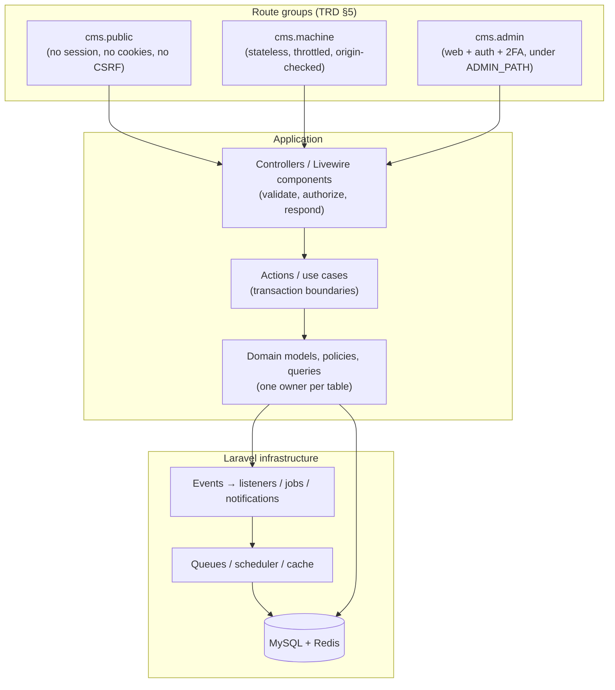

# NewsCMS

> A straightforward, maintainable Laravel-based news content management system for running a news publication website — secure admin panel, editorial workflow, and public news site in one application.


## Table of contents

- [Current status](#current-status)
- [Principles](#principles)
- [Technology stack](#technology-stack)
- [Architecture overview](#architecture-overview)
- [Prerequisites](#prerequisites)
- [Installation and local development](#installation-and-local-development)
- [Environment configuration](#environment-configuration)
- [Database and frontend assets](#database-and-frontend-assets)
- [Tests and quality checks](#tests-and-quality-checks)
- [Project documentation](#project-documentation)
- [Roadmap and phase status](#roadmap-and-phase-status)
- [Development workflow](#development-workflow)
- [Security and configuration notes](#security-and-configuration-notes)

## Current status

**In development — application baseline only.** A fresh checkout runs as a working Laravel + Livewire starter application (authentication, dashboard, settings screens). **No NewsCMS domain features (articles, taxonomy, media pipeline, themes, search, analytics) are implemented yet** — they are planned in [`docs/MASTER_PLAYBOOK.md`](docs/MASTER_PLAYBOOK.md) phases P0–P5, all currently `Planned`.

| Area | State |
|---|---|
| Starter-kit baseline (auth, dashboard, settings UI) | Implemented (unverified against NewsCMS acceptance) |
| NewsCMS domain (articles, media, themes, search, SEO, analytics, …) | Planned — see [Roadmap](#roadmap-and-phase-status) |
| Source-of-truth decisions (media, permissions, audit, settings stores) | Decided — ADR-0001…0004 in `docs/adr/` |
| Editor, languages, Contributor scope | Confirmed (TipTap; hi+en, no RTL; Reporter-minus-category/tag) — PRD §22 |
| Hosting, design targets, video, Polls scope | Awaiting decision (PRD §22, Q4–Q8) |

## Principles

- **One standalone Laravel application per news publication**, in one repository — a Laravel-native modular monolith ([ARCHITECTURE §1](docs/ARCHITECTURE.md)).
- **Laravel first**: routing, middleware, validation, auth, policies, queues, scheduler, cache, migrations, Artisan. No second framework inside Laravel.
- **No Core Composer package**, no customer-installation fleet, no multi-tenancy, no plugin marketplace in v1 ([PRD §1.3–§1.4](docs/PRD.md)).
- If it is not in the PRD, it is not in scope. Behaviour = PRD, constraints = TRD, structure = ARCHITECTURE, execution = Master Playbook.

## Technology stack

Verified against `composer.json`, `package.json`, and the installed baseline:

| Layer | Choice |
|---|---|
| Language | PHP `^8.3` (8.4 observed) |
| Framework | Laravel 13 |
| Admin UI | Livewire 4, Blade, Flux UI 2, Tailwind CSS 4, Alpine.js where useful |
| Auth | Laravel Fortify (TOTP 2FA, password reset, throttling) |
| Database | MariaDB 10.11+ locally (dedicated `newscms_test` database for tests); MySQL 8+ authoritative in CI and production-like use |
| Cache / queues / stats | Redis/Valkey per TRD; `database` drivers by default locally |
| Search | MySQL fulltext first; Scout + Meilisearch behind an interface if spikes justify it |
| Images | Intervention Image path with Imagick (planned); WebP required, AVIF conditional |
| Editor | TipTap block editor (confirmed, PRD D14) |
| Tests / quality | Pest 5, Larastan (level 7 configured), Pint (Laravel preset) |
| Assets | Vite via `vite-plus` (`npm run dev` / `npm run build`) |

Planned package candidates (installed only when their phase needs them, per [TRD §2](docs/TRD.md)): `spatie/laravel-medialibrary`, `spatie/laravel-permission`, `spatie/laravel-settings`, `spatie/laravel-activitylog`.

## Architecture overview

Per [ARCHITECTURE §5](docs/ARCHITECTURE.md), dependencies flow downward — presentation orchestrates, domain owns rules, Laravel provides infrastructure. Capability boundaries are namespaces, not Composer packages.



Key boundaries: public pages never set cookies (PRD D12); themes receive prepared data and never query or authorize (ARCHITECTURE §7); capabilities never write another capability's tables (ARCHITECTURE §5.2).

## Prerequisites

- PHP `^8.3` with `intl`, `pdo_mysql`, `mbstring`, `fileinfo` (+ `imagick`/`redis` for production-like use) — see [TRD §2](docs/TRD.md).
- Composer.
- Node.js + npm (for frontend assets).
- For production-like use: MySQL 8+, Redis/Valkey, Nginx + PHP-FPM, Supervisor/systemd workers — see [TRD §21](docs/TRD.md).

## Installation and local development

First run (from the repository root):

```bash
composer install
cp .env.example .env
php artisan key:generate
php artisan migrate
npm install
npm run build
composer dev
```

`composer dev` runs `php artisan dev` (server, queue listener, logs, and Vite together). Shortcut: `composer setup` performs install → env copy → key → migrate → assets in one step (see `composer.json` scripts).

<details>
<summary>Manual steps and useful variants</summary>

```bash
php artisan migrate --force   # releases / CI
npm run dev                   # Vite dev server with hot reload
php artisan pail              # tail application logs
php artisan about             # environment summary
```

Local development uses MariaDB/MySQL (`DB_*` settings in `.env`) with `database` cache/queue/session drivers. Tests use a dedicated `newscms_test` database and refuse to run against any other database (see `tests/TestCase.php`). MySQL 8 + Redis service containers are authoritative in CI (TRD §23).

</details>

## Environment configuration

Copy `.env.example` to `.env` and adjust at minimum `APP_URL` and the `DB_*` / `REDIS_*` settings to point at the local MariaDB/MySQL server. NewsCMS product settings (languages, media disk, cache/purge, analytics, breaking-news defaults) are defined in [PRD §21.2](docs/PRD.md); admin-editable settings arrive with Playbook P1-T03 — until then, environment and config files are the source of truth. Never commit real credentials; see [Security notes](#security-and-configuration-notes).

## Database and frontend assets

```bash
php artisan migrate            # Laravel's normal migration system (only system)
php artisan migrate:status     # pending-migration check for releases
npm run build                  # production asset build (vp build)
npm run dev                    # asset dev server (vp dev)
```

All application migrations live in `database/migrations/` and run through Laravel's migrator (TRD §3). If the UI looks stale or you see `Unable to locate file in Vite manifest`, rebuild with `npm run build` or run `npm run dev` / `composer dev`.

## Tests and quality checks

```bash
composer test                                   # config:clear + pint --test + phpstan + artisan test
php artisan test --filter='Authentication'      # narrowest relevant scope first
vendor/bin/pint --dirty --format agent          # after changing PHP files
composer types:check                            # phpstan analyse (level 7)
composer lint:check                             # pint --test
```

Tests run against the dedicated `newscms_test` database on the local MariaDB/MySQL server (`phpunit.xml`; overridable via `DB_*` env vars); the suite refuses to run if the target is not a `*test*` database. CI is authoritative on MySQL 8 + Redis service containers (TRD §23). Last verified: `composer test` green end-to-end (Pint, PHPStan level 7, 31 tests) — see `docs/phases/P0-EXECUTION-REPORT.md`.

<details>
<summary>Quality conventions</summary>

- Pest for tests (`php artisan make:test --pest Name --no-interaction`), feature tests preferred for workflows.
- Larastan level 7 configured in `phpstan.neon`; Pint Laravel preset in `pint.json`.
- `composer audit` / `npm audit` must fail CI on high severity (TRD §23).
- Prefer factories over Tinker-created models; keep tests focused and behavior-based.

</details>

## Project documentation

| Document | Describes |
|---|---|
| [AGENTS.md](AGENTS.md) | Mandatory agent instructions — read before any substantial change |
| [docs/PRD.md](docs/PRD.md) | Product behaviour, scope, roles, acceptance (Draft v1.4) |
| [docs/TRD.md](docs/TRD.md) | Stack, constraints, spikes S1–S10, testing/CI (Draft v1.4) |
| [docs/ARCHITECTURE.md](docs/ARCHITECTURE.md) | Structure, ownership, dependency rules (Draft v1.0) |
| [docs/MASTER_PLAYBOOK.md](docs/MASTER_PLAYBOOK.md) | Authoritative P0–P5 roadmap, tasks, gates (v1.0) |

Architecture Decision Records live in `docs/adr/` (ADR-0001…0004: media, permissions, audit, settings stores).

## Roadmap and phase status

From [`docs/MASTER_PLAYBOOK.md`](docs/MASTER_PLAYBOOK.md) §4 (estimates omitted until P0 baselines reality):

| Phase | Title | Status |
|---|---|---|
| P0 | Baseline and decisions (toolchain, CI, source-of-truth ADRs, spikes) | Executed — P0 OPEN, 8/10 criteria PASS ([report](docs/phases/P0-EXECUTION-REPORT.md)) |
| P1 | Foundation and admin shell (roles, auth, settings, audit, components) | Planned |
| P2 | Editorial core (articles, taxonomy, media, editor, search spike) | Planned |
| P3 | Public site and themes (URLs, theme system, SEO/feeds, caching) | Planned |
| P4 | Newsroom features and growth (breaking, embeds, scripts/ads, analytics, modules) | Planned |
| P5 | Operations and pilot (releases, backups, observability, load validation) | Planned |

P0 unblocked P1/P2: source-of-truth ADRs merged; Q1–Q3 confirmed. Still gating later phases: Q4–Q6 (hosting, servers, design targets → P5), Q7 (video → P2), Q8 (Polls → P4). Open findings: npm critical advisories, Imagick provisioning, first CI run.

## Development workflow

Per [TRD §24](docs/TRD.md): trunk-based Git with short-lived branches, required reviews, squash merges, Conventional Commits; `CODEOWNERS` for extension contracts and migrations once adopted. Every task follows [AGENTS.md](AGENTS.md): read the playbook task + cited requirements, inspect sibling code first, make the smallest compliant change, verify, and report evidence honestly.

## Security and configuration notes

- Secrets live only in `.env` (mode `640`, deploy-user owned) — never in the database or source control.
- `ADMIN_PATH` is a convenience, not a control; real controls are auth + 2FA + rate limits + policies.
- Uploads are validated by content sniffing with randomized storage paths; SVG/executables are rejected (full rules in PRD §7 / TRD §19).
- No server-side fetching of user-supplied URLs in v1 (no SSRF surface); embeds are parse-only with click-to-load.
